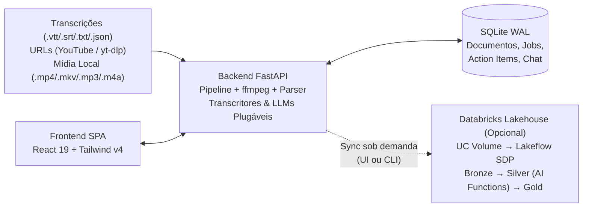

# Meeting & Video Intelligence


Aplicativo **standalone local + POC Databricks Lakehouse & IA** para ingestão unificada, transcrição multimodal (incluindo gravações corporativas > 1h sem legenda), sumarização executiva, extração estruturada de decisões/pendências/action items e chat Q&A com citações clicáveis por timestamp.

> **Documentação Arquitetural:** consulte as decisões técnicas, diagramas de arquitetura e trade-offs (ADRs) em [`docs/ARCHITECTURE_AND_DECISIONS.md`](docs/ARCHITECTURE_AND_DECISIONS.md).

---

## Arquitetura em Alto Nível



---

## Principais Recursos

### 1. Ingestão Unificada (3 Modos)
- **Transcrições prontas (Reuniões/Vídeos):** upload ou colagem direta de `.vtt`, `.srt`, `.txt` e `.json` (compatível com Microsoft Teams `<v Speaker>`, Google Meet, Zoom e Whisper JSON).
- **URLs de Vídeos (YouTube / `yt-dlp`):**
  - Busca primeiro legendas oficiais ou automáticas existentes via `youtube-transcript-api`.
  - Se não houver legenda (ou com **"Forçar transcrição por IA"** marcado), baixa automaticamente apenas a faixa de áudio otimizada via `yt-dlp` e gera `.srt` com timestamps.
- **Upload Manual de Vídeo/Áudio Local (Cenário Corporativo / Vídeos Privados):**
  - Aceita `.mp4`, `.mkv`, `.mov`, `.webm`, `.avi`, `.mp3`, `.wav`, `.m4a`, `.ogg`, `.aac`, `.opus`, `.flac` (ex.: gravações baixadas do SharePoint, Teams, Stream ou Google Drive).
  - Extrai/comprime automaticamente a faixa de áudio (`mono 16kHz 48kbps` via `ffmpeg`) e segmenta mídias longas (> 1h / > 2h) em blocos configuráveis (~20 min) com recomposição exata de timestamps `.srt`, evitando truncamento de saída.

### 2. Motores Plugáveis (Provider Pattern)

| Camada | Provedores Suportados | Caso de Uso Principal |
|---|---|---|
| **Transcritores** | `gemini` *(padrão)* | Google Gemini Multimodal + Files API resumable + chunking automático + glossário técnico |
| **Transcritores** | `local_whisper` | Transcrição **100% offline** com `faster-whisper` (sigilo corporativo) |
| **LLMs** | `gemini`, `openai`, `azure_openai` | Sumarização, extração JSON validada e Q&A em nuvem |
| **LLMs** | `databricks` | Databricks Model Serving / Unity Gateway (`system.ai.*`) |
| **LLMs** | `ollama` | LLM **100% local** (ex.: `llama3.1:8b`) |
| **LLMs** | `heuristic` | Fallback determinístico offline para testes/demos sem API Key |

### 3. Extração Estruturada, Biblioteca & Chat Q&A
- **Templates de Extração:** `Reunião Corporativa`, `Aula/Vídeo Técnico` e `Discovery/Cliente`.
- **Saída Validada (Pydantic v2):** Metadados, Resumo Executivo, Decisões, Pendências/Bloqueios, Action Items (checklist interativo persistido em SQLite WAL), Informações-Chave (insights, aprendizados técnicos, métricas, riscos, tecnologias) e **Ata Markdown pronta para copiar/colar**.
- **Chat Q&A sobre a Transcrição:** perguntas específicas respondidas com citações clicáveis `[HH:MM:SS]`.
- **Exportações:** `.md`, `.srt`, `.txt`, `.json`.
- **Sincronização Databricks:** envio sob demanda para Volume do Unity Catalog + acionamento opcional da pipeline Lakeflow pela UI ou pela CLI.

---

## Estrutura do Projeto

```text
meeting-video-intelligence/
├── .env.example                            # Template de variáveis (zero segredos hardcoded)
├── pyproject.toml                          # Metadados Python, dependências opcionais e config pytest
├── docs/
│   └── ARCHITECTURE_AND_DECISIONS.md       # Arquitetura detalhada e ADRs (decisões técnicas)
├── backend/
│   ├── requirements.txt                    # Dependências do backend FastAPI
│   └── app/
│       ├── main.py                         # Entrada FastAPI + serving opcional de frontend/dist
│       ├── config.py                       # Config em camadas (SQLite > .env > defaults) + mascaramento
│       ├── db.py                           # Persistência SQLite em WAL mode
│       ├── schemas.py                      # Contratos Pydantic v2 (StructuredAnalysis + API)
│       ├── cli.py                          # Interface de linha de comando (ingest, list, export, push)
│       ├── routers/                        # Rotas REST (/api/ingest, /api/documents, /api/settings)
│       └── services/
│           ├── pipeline.py                 # Orquestrador unificado (API + CLI)
│           ├── media.py                    # YouTube captions, yt-dlp, compressão e chunking ffmpeg
│           ├── parser.py                   # Normalizador .srt/.vtt/.txt/.json + merge com offset
│           ├── databricks_sync.py          # Upload REST Files API / CLI + trigger Lakeflow Pipeline
│           ├── transcribers/               # BaseTranscriber, GeminiTranscriber, LocalWhisperTranscriber
│           └── llm/                        # BaseLLMProvider, Gemini, OpenAI/Azure/Ollama, Databricks, Heuristic
├── frontend/                               # React 19 + TypeScript + Vite 6 + Tailwind CSS v4
│   └── src/
│       ├── api/client.ts                   # Cliente HTTP tipado
│       └── components/                     # IngestPanel, LibraryView, DocumentDetail, TranscriptChat, SettingsView
├── databricks/                             # Databricks Asset Bundle (DAB) + Lakeflow SDP Medallion
│   ├── databricks.yml                      # Definição parametrizável (Schema, Volume, Pipeline Serverless)
│   ├── README_DEPLOY.md                    # Guia passo a passo de deploy no workspace Databricks
│   └── src/pipelines/meeting_intelligence/transformations/
│       ├── bronze_transcricoes.py          # Auto Loader (cloudFiles)
│       ├── silver_transcricoes.py          # Limpeza + AI Functions v2.0 (ai_classify, ai_summarize, ai_extract)
│       └── gold_tabelas_analiticas.py      # 4 Materialized Views com Liquid Clustering
└── tests/                                  # Suíte Pytest (parser, fallback/chunking, schema LLM, API E2E)
```

---

## Instalação e Execução Local

### Pré-requisitos
- **Python 3.12+**
- **Node.js 20+**
- **Opcional (recomendado para vídeos locais pesados e áudios > 1h):** `ffmpeg` no `PATH` ou `pip install imageio-ffmpeg`
- **Opcional (sigilo 100% offline):** `pip install faster-whisper`

### 1. Configurar e Rodar o Backend
```powershell
python -m venv .venv
.venv\Scripts\pip.exe install -r backend\requirements.txt
copy .env.example .env
```

Edite `.env` com suas credenciais (ou configure diretamente pela tela **Configurações** na interface web — sem API Key, o app usa o modo `heuristic` offline automaticamente).

Iniciar a API FastAPI (porta padrão `8000`):
```powershell
.venv\Scripts\python.exe -m uvicorn app.main:app --app-dir backend --reload --host 127.0.0.1 --port 8000
```
- Swagger / OpenAPI: `http://127.0.0.1:8000/docs`
- Healthcheck: `http://127.0.0.1:8000/api/health`

### 2. Configurar e Rodar o Frontend (Dev)
```powershell
cd frontend
npm install
npm run dev
```
> **Dica para Windows PowerShell:** caso a política de execução bloqueie `npm.ps1`, execute `npm.cmd install` e `npm.cmd run dev`.

Acesse: **http://localhost:5173**

### 3. Modo Single-Server ou Portas Customizadas
Para rodar tudo em uma única porta (ou evitar conflito com outros serviços locais nas portas `8000`/`5173`):

```powershell
# 1. Compilar o frontend
cd frontend
npm run build
cd ..

# 2. Subir o FastAPI em qualquer porta livre (ex.: 8010) — ele serve frontend/dist automaticamente
.venv\Scripts\python.exe -m uvicorn app.main:app --app-dir backend --host 127.0.0.1 --port 8010
```
Acesse: **http://127.0.0.1:8010**

---

## Uso 100% Offline (Sigilo Corporativo)

Para reuniões confidenciais que não podem trafegar em nuvens externas:
1. Instale o Whisper local e o `ffmpeg` embarcado:
   ```powershell
   .venv\Scripts\pip.exe install faster-whisper imageio-ffmpeg
   ```
2. Suba um modelo local no [Ollama](https://ollama.com/) (ex.: `ollama run llama3.1:8b`) **ou** utilize o provedor determinístico `heuristic`.
3. Em **Configurações** na UI (ou no `.env`), defina:
   ```env
   TRANSCRIBER_PROVIDER=local_whisper
   LLM_PROVIDER=ollama   # ou heuristic
   ```

---

## Uso via CLI

```powershell
$env:PYTHONPATH = "backend"

# Ingerir vídeo do YouTube (com fallback automático via yt-dlp se não houver legenda)
.venv\Scripts\python.exe -m app.cli ingest "https://www.youtube.com/watch?v=VIDEO_ID" --template "Aula/Vídeo Técnico"

# Ingerir gravação local sem legenda (.mp4 / .m4a) ou transcrição (.vtt / .srt)
.venv\Scripts\python.exe -m app.cli ingest "C:\Videos\reuniao_teams.mp4" --title "Comite Arquitetura" --output-md ".\ata.md"

# Listar documentos e exportar
.venv\Scripts\python.exe -m app.cli list
.venv\Scripts\python.exe -m app.cli export <DOC_ID> --format srt --output .\legenda.srt

# Enviar transcrição gerada para o Volume do Unity Catalog no Databricks
.venv\Scripts\python.exe -m app.cli push-databricks <DOC_ID> --run-pipeline
```

---

## Deploy da POC no Databricks Lakehouse

A pasta [`databricks/`](databricks/README_DEPLOY.md) contém um **Databricks Asset Bundle (DAB)** 100% independente e parametrizável (`catalog`, `schema`, `volume_name`) implementando a arquitetura Medallion serverless com **Lakeflow Spark Declarative Pipelines** e **Databricks AI Functions**:

- **Bronze:** `bronze_transcricoes_raw` (Auto Loader `cloudFiles`)
- **Silver:** `silver_transcricoes_enriquecidas` (Limpeza + `ai_classify`, `ai_summarize`, `ai_extract` v2.0 com JSON schema estruturado)
- **Gold:** `gold_transcricoes_catalogo`, `gold_action_items`, `gold_decisoes`, `gold_pendencias`

Consulte o guia passo a passo em [`databricks/README_DEPLOY.md`](databricks/README_DEPLOY.md).

---

## Testes Automatizados

```powershell
.venv\Scripts\python.exe -m pytest -v
```

A suíte cobre:
- Parsing e normalização de `.srt`, `.vtt` (Teams/Zoom), `.json` (Whisper) e merge de chunks com offset (`tests/test_parser.py`);
- Detecção de URLs YouTube, fallback automático quando não há legendas e fluxo de vídeo local (`tests/test_ingestion_fallback.py`);
- Extração resiliente de JSON e validação de schema Pydantic v2 / provedor heurístico (`tests/test_llm_schema.py`);
- Ciclo completo da API REST de ingestão, biblioteca, checklist, chat e exportações (`tests/test_api.py`).
