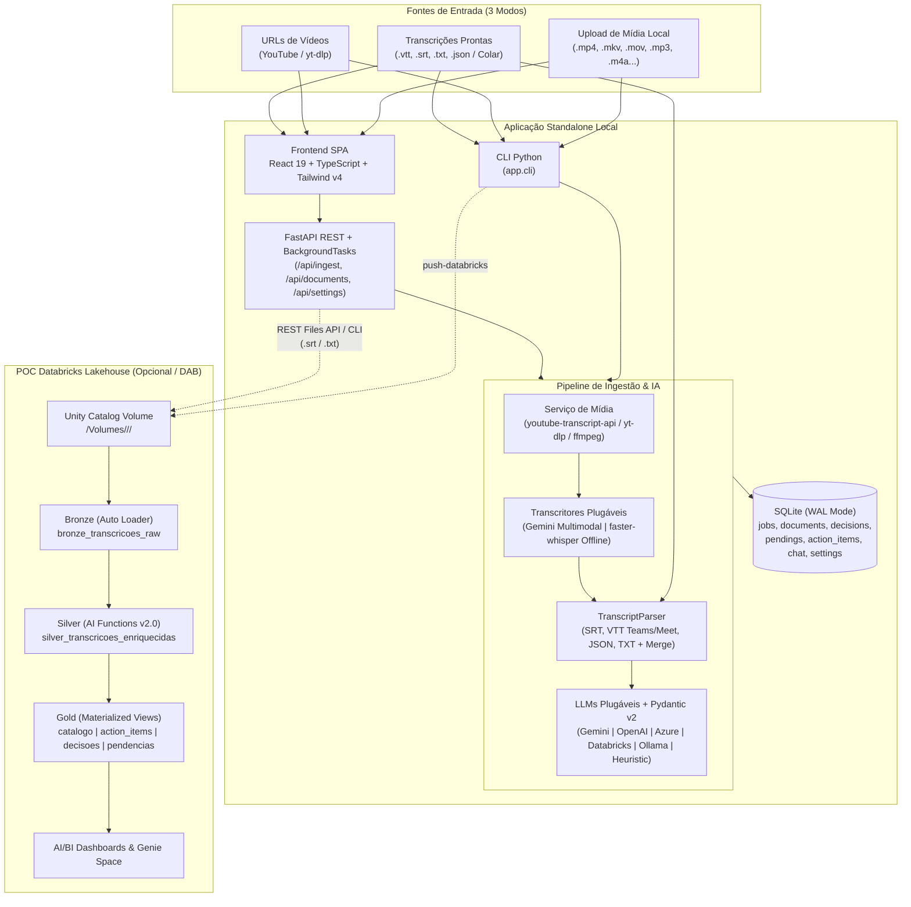

# Arquitetura e Decisões Técnicas (ADRs)

Este documento registra a arquitetura geral do **Meeting & Video Intelligence** e as principais decisões técnicas (**Architecture Decision Records — ADRs**), incluindo o contexto, as escolhas adotadas, as alternativas consideradas e os trade-offs assumidos.

---

## 1. Visão Geral da Arquitetura

O projeto foi desenhado sob uma **arquitetura híbrida em duas camadas desacopladas**:

1. **Aplicação Standalone Local (`backend/` + `frontend/`):** funciona de forma autônoma na máquina do usuário (inclusive 100% offline para reuniões sigilosas), oferecendo ingestão unificada, transcrição multimodal, análise estruturada via LLM, gestão interativa de pendências/action items, chat Q&A com citações e exportações.
2. **POC Databricks Lakehouse (`databricks/`):** pipeline analítica serverless corporativa empacotada como **Databricks Asset Bundle (DAB)** usando **Lakeflow Spark Declarative Pipelines (`pyspark.pipelines`)** e **Databricks AI Functions**, acoplada ao app local de forma leve via **Unity Catalog Volumes**.



---

## 2. Registro de Decisões Arquiteturais (ADRs)

### ADR-01: Arquitetura Híbrida (App Standalone Local + POC Databricks Desacoplada)
- **Contexto:** Equipes de engenharia e negócio frequentemente precisam processar tanto vídeos públicos/técnicos quanto gravações corporativas confidenciais (Teams, SharePoint, Drive) sem depender de infraestrutura em nuvem provisionada previamente — ao mesmo tempo em que desejam consolidar métricas, decisões e planos de ação corporativos em um Lakehouse governado.
- **Decisão:** Manter o aplicativo local 100% funcional sem nuvem obrigatória, e estruturar a camada Databricks (`databricks/`) como um **Databricks Asset Bundle (DAB)** independente que consome arquivos `.srt`/`.txt` enviados sob demanda para um **Unity Catalog Volume**.
- **Alternativas consideradas:**
  - *App exclusivo dentro de Databricks Apps:* inviabilizaria uso offline/local e dificultaria testes sem workspace ativo.
  - *Acoplamento direto via JDBC/SQL Warehouse a partir do app local:* aumentaria complexidade de rede, drivers e latência no fluxo de captura.
- **Consequências / Trade-offs:**
  - **Prós:** Zero lock-in; onboarding em minutos localmente; integração corporativa opcional via REST Files API (com fallback para Databricks CLI).
  - **Contras:** A camada local (SQLite) e o Lakehouse (Delta Tables) mantêm armazenamentos distintos, sincronizados de forma explícita pelo usuário/CLI (sem sincronização bidirecional automática).

---

### ADR-02: FastAPI + `BackgroundTasks` + SQLite em Modo WAL
- **Contexto:** Processamentos de áudio/vídeo longos (extração `ffmpeg`, transcrição e análise LLM) levam dezenas de segundos a alguns minutos e não podem bloquear requisições HTTP, mas o app standalone precisa rodar localmente sem exigir Docker, PostgreSQL ou Redis.
- **Decisão:** Utilizar **FastAPI** com execução assíncrona via `BackgroundTasks` combinada a um **SQLite em modo WAL** (`PRAGMA journal_mode=WAL;`, `PRAGMA foreign_keys=ON;`, `timeout=30.0`) persistindo o estado dos jobs (`Recebido → Extraindo Áudio → Transcrevendo → Analisando com LLM → Concluído`) consultado por polling na UI.
- **Alternativas consideradas:**
  - *Celery/RQ + Redis + PostgreSQL:* robusto para produção distribuída, mas excessivo para uma ferramenta standalone local.
  - *Processamento síncrono:* causaria timeouts de navegador/proxy em vídeos longos.
- **Consequências / Trade-offs:**
  - **Prós:** Zero infraestrutura externa; leituras concorrentes (UI fazendo polling) não travam durante escritas; integridade referencial com `ON DELETE CASCADE` entre documentos, decisões, pendências, action items e chat.
  - **Contras:** Jobs em memória (`BackgroundTasks`) são interrompidos se o processo do servidor for reiniciado durante a execução. Para cenários multi-usuário em produção, recomenda-se evoluir para fila persistente (Celery/Temporal/Databricks Jobs) e banco gerenciado (PostgreSQL/Lakebase).

---

### ADR-03: Provider Pattern para Transcritores e LLMs (com Modo 100% Offline)
- **Contexto:** Diferentes contextos exigem modelos distintos por custo, qualidade, latência, governança corporativa ou sigilo total de dados.
- **Decisão:** Adotar o padrão **Provider / Strategy** com interfaces abstratas (`BaseTranscriber` e `BaseLLMProvider`) e fábricas configuráveis em tempo de execução:
  - **Transcritores:** `gemini` (Google Gemini Multimodal) e `local_whisper` (`faster-whisper` com `vad_filter=True` e `compute_type=int8`, 100% offline).
  - **LLMs:** `gemini`, `openai`, `azure_openai`, `databricks` (Model Serving / Unity Gateway `system.ai.*`), `ollama` (LLM local) e `heuristic` (extrator determinístico offline).
- **Alternativas consideradas:**
  - *SDK único (ex.: apenas OpenAI ou apenas LangChain):* cria dependência forte de fornecedor e adiciona peso desnecessário de abstrações.
- **Consequências / Trade-offs:**
  - **Prós:** Troca de provedor sem alterar regras de negócio; suporte real a ambientes *air-gapped*/confidenciais (`local_whisper` + `ollama`/`heuristic`); fallback automático para `heuristic` permite demonstrar e testar o app mesmo sem API Key configurada; integrações HTTP implementadas com `urllib.request` da biblioteca padrão para manter o núcleo leve e previsível.
  - **Contras:** Recursos proprietários específicos de cada provedor (ex.: structured outputs nativos de cada API) precisam ser normalizados na camada base (`BaseLLMProvider`).

---

### ADR-04: Pipeline de Mídia para Vídeos Longos (> 1h / > 2h) com Compressão, Chunking e Files API
- **Contexto:** Gravações de reuniões corporativas em `.mp4`/`.mkv` frequentemente passam de 500 MB e 1 a 2 horas de duração. Enviar o vídeo bruto diretamente para uma LLM causa estouro de payload, lentidão de upload e truncamento da transcrição devido ao limite de tokens de saída.
- **Decisão:** Implementar um pipeline de mídia em 3 etapas (`services/media.py` + `services/transcribers/gemini.py`):
  1. **Extração e compressão via `ffmpeg`:** descarta vídeo (`-vn`) e converte o áudio para **mono, 16 kHz, 48 kbps (`.mp3`)**, reduzindo drasticamente o tamanho mantendo inteligibilidade para fala. Suporta `ffmpeg` do sistema ou o binário embarcado via `imageio-ffmpeg`.
  2. **Segmentação automática (chunking):** áudios maiores que `AUDIO_CHUNK_MINUTES` (padrão `20 min`) são fatiados em blocos com offset conhecido. Cada bloco é transcrito com `maxOutputTokens=65536` e `temperature=0.1`.
  3. **Upload adaptativo e limpeza remota:** chunks `<= 15 MB` vão como `inline_data` base64; arquivos `> 15 MB` usam **Gemini Files API (upload resumable)** com polling do estado `ACTIVE` e remoção garantida do arquivo remoto no bloco `finally`.
  4. **Recomposição exata de timestamps:** `TranscriptParser.merge_srt_chunks()` desloca todos os timestamps de cada bloco pelo seu `offset_seconds` e renumera a legenda `.srt` final de forma contínua.
- **Alternativas consideradas:**
  - *Envio do arquivo completo em uma única chamada:* falha por truncamento de saída acima de ~30–40 min de fala densa.
  - *Dependência obrigatória de `ffmpeg` no PATH:* gera atrito no Windows; o fallback para `imageio-ffmpeg` resolve isso.
- **Consequências / Trade-offs:**
  - **Prós:** Transcrição confiável de gravações de 1h–3h+; menor custo de rede e armazenamento; nenhuma mídia residual deixada na nuvem ou em `data/uploads/`.
  - **Contras:** Fronteiras exatas entre chunks (a cada 20 min) podem cortar uma frase ao meio; futura melhoria pode adicionar sobreposição (overlap) de 5–10s com deduplicação.

---

### ADR-05: Ingestão Unificada em Cascata e Parser Multi-formato
- **Contexto:** Usuários recebem transcrições de ferramentas heterogêneas (Microsoft Teams `.vtt` com `<v Nome>`, Zoom, Google Meet, Whisper `.json`, `.srt`, texto colado) além de URLs de vídeos com ou sem legendas.
- **Decisão:**
  - **Cascata para URLs:** tenta primeiro extrair legendas nativas/automáticas do YouTube via `youtube-transcript-api` (compatível com versões `0.6.x` e `1.x`, custo zero e latência baixa). Se indisponível — ou se o usuário marcar **"Forçar transcrição por IA"** — faz fallback automático baixando apenas a melhor faixa de áudio via `yt-dlp` (`bestaudio[ext=m4a]/bestaudio/best`) e envia ao transcritor configurado.
  - **Parser único (`TranscriptParser`):** normaliza `.srt`, `.vtt`, `.json` e `.txt` para uma representação interna canônica de segmentos (`index`, `inicio`, `fim`, `start_seconds`, `end_seconds`, `speaker`, `texto`) + texto limpo + `.srt` reconstruído. Quando recebe `.txt` sem timestamps, estima duração com base em ~145 palavras/minuto para manter metadados consistentes.
- **Consequências / Trade-offs:**
  - **Prós:** Todo o restante do pipeline (análise LLM, chat com citações, exportação e sync Databricks) opera sobre um contrato único e previsível.
  - **Contras:** A acurácia de extração de locutores em `.txt` depende de convenções de prefixo (`Nome: fala`), e legendas automáticas do YouTube têm menos pontuação que a transcrição por IA (motivo pelo qual existe o toggle *Forçar transcrição por IA*).

---

### ADR-06: Contratos Estritos com Pydantic v2 e Prompts Orientados a Templates
- **Contexto:** Saídas de LLMs frequentemente variam na formatação (cercas ```json```, variações de casing em prioridades/status, strings onde se espera lista, ou atas incompletas).
- **Decisão:**
  - Definir o contrato `StructuredAnalysis` em **Pydantic v2** (`schemas.py`) com validadores defensivos (`normalize_priority`, `normalize_status`, `coerce_participants`).
  - Extrair JSON de forma tolerante (`extract_json_object`) e complementar metadados conhecidos deterministicamente (`validate_and_normalize_analysis`).
  - Garantir sempre uma Ata Markdown bem formatada: se a LLM omitir ou gerar uma ata muito curta (`< 40` chars), `render_ata_markdown()` gera a ata deterministicamente a partir dos campos estruturados.
  - Especializar o prompt por **Template de Extração** (`Reunião Corporativa`, `Aula/Vídeo Técnico`, `Discovery/Cliente`) e injetar **glossário técnico** configurável.
- **Consequências / Trade-offs:**
  - **Prós:** Persistência relacional confiável nas tabelas `decisions`, `pendings` e `action_items`; UI nunca quebra por variações menores da LLM.
  - **Contras:** O prompt de análise limita o texto enviado a `180.000` caracteres (e `120.000` caracteres / 450 segmentos no Q&A) para respeitar janelas menores de modelos locais (ex.: Ollama). Para transcrições ainda maiores, o caminho natural de evolução é map-reduce ou busca vetorial.

---

### ADR-07: Configuração em Camadas e Segurança por Padrão (Zero Secrets Hardcoded)
- **Contexto:** O projeto precisa ser compartilhável em repositório público/corporativo sem risco de vazamento de tokens, caminhos pessoais ou schemas privados, mantendo facilidade de configuração tanto por arquivo quanto pela UI.
- **Decisão:**
  - **Precedência clara:** `1. SQLite (app_settings)` → `2. Variáveis de ambiente / .env` → `3. Defaults genéricos`.
  - **Proteção de segredos:** campos sensíveis (`SECRET_FIELDS`) são sempre retornados mascarados (`mask_secret`) nas rotas `GET /api/settings`, acompanhados de flags booleanas `*_configured`. Ao salvar via UI, qualquer valor contendo `****` é ignorado para não sobrescrever o segredo original.
  - **Higiene de disco:** uploads temporários em `data/uploads/` são removidos no bloco `finally` após o término do job; `.env`, `data/` e `*.db*` ficam explicitamente no `.gitignore`.
- **Consequências / Trade-offs:**
  - **Prós:** Repositório 100% limpo e auditável; experiência fluida para usuários não técnicos via tela de Configurações.
  - **Contras:** No modo standalone local, as chaves salvas via UI ficam armazenadas no SQLite local (`data/meeting_intelligence.db`); em deploys compartilhados/servidor, recomenda-se fornecer segredos exclusivamente via variáveis de ambiente ou secret manager (Key Vault / Databricks Secrets) e restringir acesso ao banco.

---

### ADR-08: Frontend React 19 + TypeScript + Vite + Tailwind CSS v4 e Modo Single-Server
- **Contexto:** A interface precisa oferecer ingestão drag-and-drop, barra de progresso em tempo real, biblioteca filtrável, checklist interativo de action items/pendências, chat Q&A com timestamps clicáveis e tela de configurações — com build rápido e deploy local descomplicado.
- **Decisão:**
  - Construir SPA em **React 19 + TypeScript + Vite 6 + Tailwind CSS v4** (`lucide-react` para ícones), sem dependências pesadas de state management (estado local e client tipado em `src/api/client.ts`).
  - Em desenvolvimento, o Vite faz proxy de `/api` para o FastAPI (`vite.config.ts`).
  - Em produção local (**Modo Single-Server**), o FastAPI detecta automaticamente `frontend/dist/index.html` e serve a SPA na própria porta do backend (`app.mount("/", StaticFiles(...))`).
- **Consequências / Trade-offs:**
  - **Prós:** Menor superfície de dependências, build sub-segundo e possibilidade de rodar toda a aplicação em uma única porta quando desejado.
  - **Contras:** Não utiliza SSR (desnecessário para uma ferramenta operacional interna/local).

---

### ADR-09: POC Databricks com DAB + Lakeflow SDP + AI Functions v2.0 + Liquid Clustering
- **Contexto:** Para escalar a inteligência de reuniões em nível corporativo (governança de acesso, histórico cross-reuniões, dashboards executivos e consultas em linguagem natural via Genie), é necessário uma arquitetura Lakehouse moderna, declarativa e parametrizável.
- **Decisão:**
  - **Infraestrutura como Código:** empacotar Schema, Volume gerenciado e Pipeline Serverless em **Databricks Asset Bundle (`databricks.yml`)** totalmente parametrizável (`catalog`, `schema`, `volume_name`, `categories_json`), com targets `dev` e `prod`.
  - **Medalhão com Lakeflow Spark Declarative Pipelines (`pyspark.pipelines`):**
    - **Bronze (`bronze_transcricoes_raw`):** Streaming Table com Auto Loader (`cloudFiles`, `wholetext=true`, `pathGlobFilter`) + `cluster_by_auto=True` + hash determinístico `sha2(_metadata.file_path, 256)`.
    - **Silver (`silver_transcricoes_enriquecidas`):** higienização regex de VTT/SRT/HTML, expectation de qualidade (`@dp.expect_or_drop("conteudo_valido", ...)`), `delta.enableRowTracking=true`, `cluster_by=["categoria_ia", "tipo_midia"]` e enriquecimento em passo único com **Databricks AI Functions**: `ai_classify` (v2.0), `ai_summarize` e `ai_extract` (v2.0 com JSON Schema estruturado retornando `VARIANT`).
    - **Gold (4 Materialized Views):** `gold_transcricoes_catalogo`, `gold_action_items`, `gold_decisoes` e `gold_pendencias`, normalizando arrays via `explode_outer(variant_get(...))` com **Liquid Clustering** alinhado aos filtros de BI/Genie.
- **Consequências / Trade-offs:**
  - **Prós:** Zero gerenciamento de clusters ou endpoints de modelo; governança nativa no Unity Catalog; tabelas Gold prontas para Databricks AI/BI Dashboards e Genie Space.
  - **Contras:** Requer workspace Databricks com Unity Catalog, Serverless Compute e AI Functions v2.0 habilitados.

---

## 3. Evoluções Futuras Recomendadas

| Tema | Situação Atual | Próximo Passo Recomendado |
|---|---|---|
| **Processamento de Jobs** | `FastAPI BackgroundTasks` em processo único | Fila persistente (Celery/ARQ/Redis ou Databricks Jobs) para retomada após restart e multi-usuário |
| **Q&A em Vídeos Muito Longos** | Recorte até 450 segmentos / 120k chars no prompt | Indexação híbrida (FTS5 no SQLite / Vector Search no Databricks) para recuperação por relevância (RAG) |
| **Fronteira de Chunks de Áudio** | Cortes fixos de 20 min via `ffmpeg` | Sobreposição (overlap) de 5–10s entre blocos com deduplicação de frases na costura |
| **Diarização Offline** | `faster-whisper` transcreve sem separar locutores automaticamente | Integrar `pyannote.audio` opcional para identificação de speakers offline |
| **Qualidade & Entrega Contínua** | Suíte `pytest` local (11 testes) + `tsc -b` | Adicionar workflow GitHub Actions rodando `pytest` + build TypeScript a cada PR/push |
